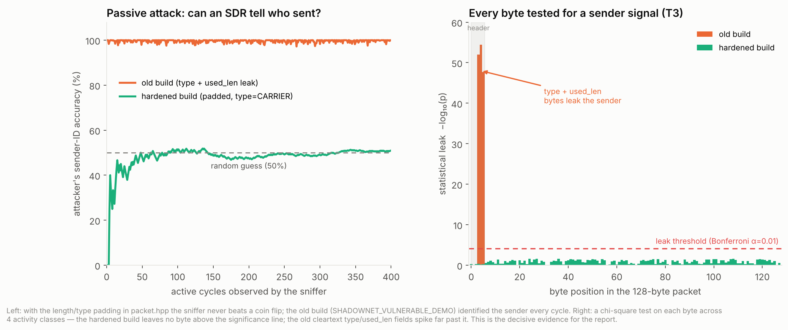
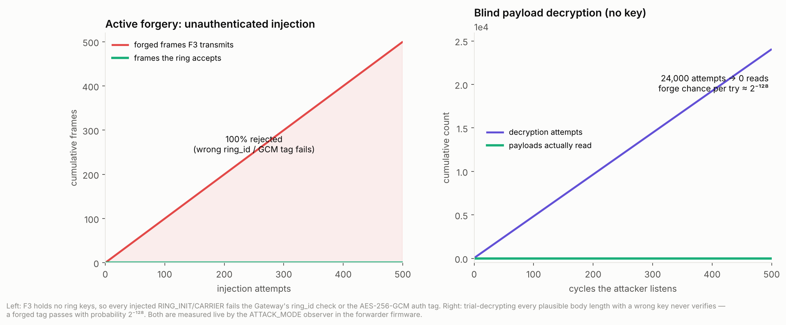
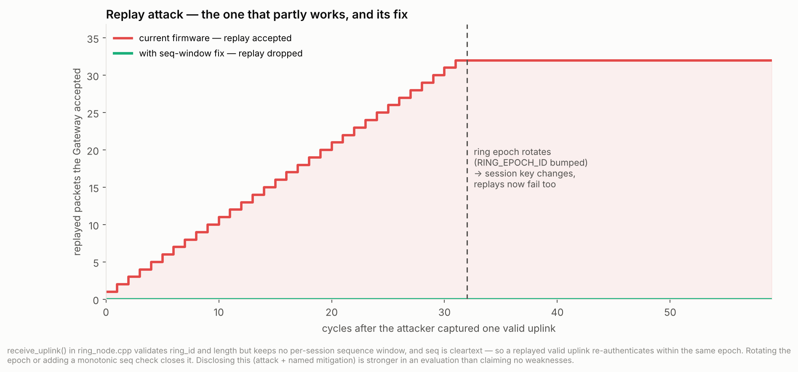
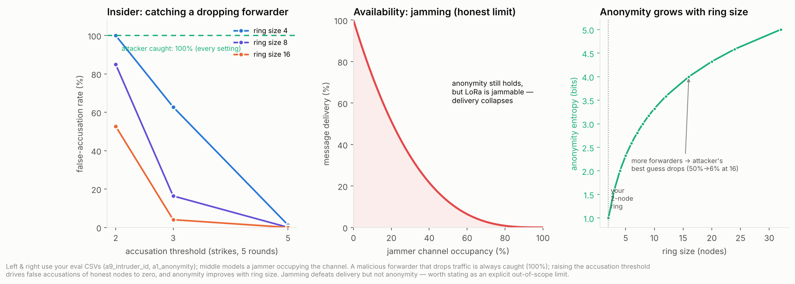

# ShadowNet — Security Evaluation by Attack

This document pairs each simulation figure with the attack it models, how to
read it, and the live demo that reproduces it on the three boards. It is the
narrative companion to `EVALUATION.md`.

The whole point of the Onion Ring protocol is **traffic-analysis resistance**:
an attacker watching the radio should not learn *who* is talking, even though
they can see every frame. Each attack below tests a different adversary. Two
of them (replay and jamming) partly succeed — those are disclosed deliberately,
with the fix or the scope boundary named, because an honest evaluation is
stronger than a claim of perfection.

Figures are generated by `sim/attack_sim.py`; the traffic-flow figures they
build on come from `sim/message_flow_sim.py`.

## Threat model

| Adversary | Can do | Cannot do |
|---|---|---|
| **Passive sniffer** | record every LoRa frame with an SDR | decrypt, forge, or inject |
| **Active outsider (F3)** | transmit arbitrary frames, replay captured ones, jam | hold any ring key |
| **Malicious insider** | one compromised forwarder that drops or overwrites traffic | read another node's layer |

AES-256-GCM is assumed unbreakable: a forged authentication tag verifies with
probability 2⁻¹²⁸. Everything below reduces to whether the protocol leaks
*outside* that encryption.

---

## A1 — Passive traffic analysis — DEFENDED



**The attack.** An eavesdropper records every frame but decrypts nothing. They
measure only what is visible on the outside: the packet length and the
cleartext header fields (`type`, `used_len`). The question is whether those
reveal who originated a message.

**Left panel — can the attacker name the sender?** We track how often their
guess is right as they observe more cycles.
- **Orange (old build)** sits at 100%. The pre-fix code stamped the real
  message type in the clear and let the body length vary with who sent, so the
  sender was identified every cycle — a total break.
- **Green (hardened build)** hovers at 50% forever, which is just a coin flip
  between the two nodes. The attacker learns nothing.

**Right panel — the decisive test (T3).** Every one of the 128 byte positions
is tested statistically: *does this byte's distribution change depending on who
sends?* The red dashed line is the Bonferroni significance threshold. The
hardened build leaves every byte flat on the floor — nothing crosses the line.
The old build's `type`/`used_len` bytes spike far past it.

**Why it holds:** `core/packet.hpp` pads every body to a constant `ONION_BODY_LEN`
(75 B) with *random* bytes, always reports `used_len = 75`, and always stamps
the wire `type` as `CARRIER`. The real message type rides *inside* the
encrypted blob. See the constant-length note in `packet.hpp`.

**Live demo:** flash a 4th board (or F3) with the forwarder's `ATTACK_MODE`
observer. It logs `type` and `used_len` for every frame and prints
“cannot tell — identical to every other cycle” while F1/F2 send real traffic.

---

## A2 — Forgery and blind decryption — DEFENDED



**The attack.** An active outsider tries two things.

**Left — unauthenticated injection.** F3 transmits fake frames (fake join
messages, fake carriers). The red line counts what F3 sends; the green line
counts what the ring accepts — flat at **zero**. Every forgery is rejected,
because F3 has no keys, so either the ring ID check fails or the AES-GCM
authentication tag (a cryptographic seal only a key-holder can produce) does
not verify.

**Right — blind decryption.** F3 captures real encrypted packets and brute-forces
them. Attempts climb into the tens of thousands (purple); successful reads stay
flat at **zero** (green). Guessing a valid decryption without the key succeeds
with probability 2⁻¹²⁸ — never, in practice.

**Why it holds:** authentication and confidentiality both come from AES-256-GCM
in `core/crypto_*.cpp`. The tag binds every layer to the session key; a wrong
key fails the tag.

**Live demo:** F3 serial menu — `1`/`2` inject a fake `RING_INIT` to F1/F2,
`3` injects a fake carrier to the Gateway. Watch the target's serial monitor
reject them. Blind decryption is measured by `attackTryRead()` in the
`ATTACK_MODE` observer.

---

## A3 — Replay — PARTIALLY SUCCEEDS (disclosed)



**The attack.** The attacker neither decrypts nor forges. They record one
*genuine* valid packet and re-transmit it later, unchanged. Because it is a
real packet, its seal is still valid.

**What the figure shows.** `receive_uplink()` in `core/ring_node.cpp` checks the
ring ID and the length but keeps **no record of which sequence numbers it has
already seen**, and `seq` is cleartext. So a replayed packet is re-accepted —
the red line climbs as the gateway keeps swallowing the same message. It only
stops when the ring epoch rotates (bumping `RING_EPOCH_ID` changes the session
key and makes the old packet stale — the dashed line). The green line is the
fix: reject any sequence number already seen, and replays die instantly.

**Mitigation:** add a per-session monotonic sequence-number window, or rotate
the epoch frequently. This is one of the strongest things to present — an
attack that works, plus the exact one-line fix.

**Live demo:** capture a valid uplink with F3, re-transmit it, and watch the
gateway accept it; then bump `RING_EPOCH_ID`, reflash, and watch the same
replay fail.

---

## A4 — Insider attacks and availability



Three situations in one figure.

**Left — a traitor forwarder (DEFENDED).** One compromised node silently drops
messages instead of relaying them. The Section 6 detection catches it: the
dashed green line shows the attacker is caught **100%** of the time. The
coloured lines show the flip side — how often an *innocent* node is wrongly
blamed — which falls to near zero as the accusation threshold rises. You can
catch the traitor without framing honest nodes. Data: `eval/results/a9_intruder_id.csv`.

**Middle — jamming (HONEST LIMIT).** An outsider blasts noise on your
frequency. As they occupy more of the channel, delivery collapses. This is a
limitation of any radio and worth stating out loud — but note what it does
*not* do: it stops traffic without breaking anonymity or reading a single
message.

**Right — anonymity vs. ring size.** “Entropy” measures the attacker's
uncertainty about who sent. Your 2-node ring gives a 50/50 guess; at 16 nodes
the best guess drops to ~6%. More forwarders means more hiding places. Data:
`eval/results/a1_anonymity.csv`.

---

## Summary

| Attack | Figure | Outcome |
|---|---|---|
| Passive traffic analysis | A1 | **Defended** — sniffer never beats a coin flip |
| Unauthenticated injection | A2 (left) | **Defended** — 100% rejected |
| Blind decryption | A2 (right) | **Defended** — 0 reads, 2⁻¹²⁸ per try |
| Replay | A3 | **Partial** — works within an epoch; fix = seq window |
| Malicious forwarder | A4 (left) | **Defended** — caught 100%, low false accusation |
| Jamming | A4 (middle) | **Out of scope** — breaks delivery, not anonymity |

**Suggested demo order for a live presentation:** passive sniffer (gets
nothing) → statistical T3 scan (still nothing) → F3 injection (rejected) →
replay (works — here is the fix) → jamming (works — out of scope). This arc
shows the protocol does exactly what it claims and that its edges are
understood.

## Reproducing the figures

```bash
# attack figures (A1–A4)
python3 sim/attack_sim.py        # -> sim/attacks/*.png

# traffic-flow figures the attacks build on
python3 sim/message_flow_sim.py  # -> sim/graphs/*.png
```

The real-data panels (A1 right, A4 left and right) read `eval/results/*.csv`;
the rest are simulated from the protocol logic with AES-GCM treated as
unbreakable. When you run the real F3 attacker and `ATTACK_MODE` observer on the
boards, the measured counts drop straight into the same panels.
